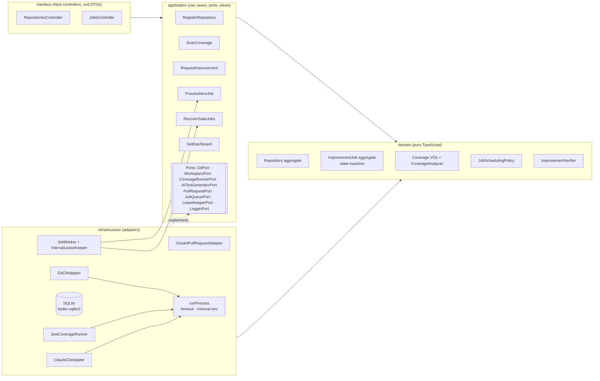
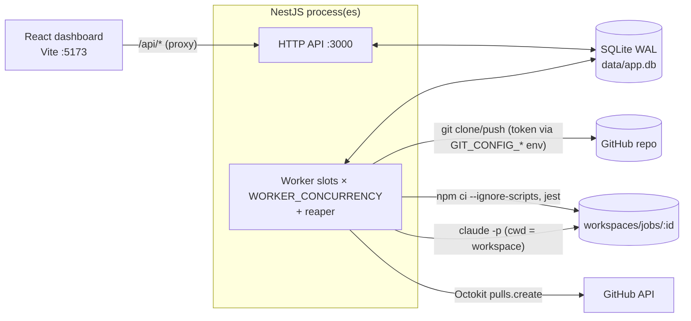
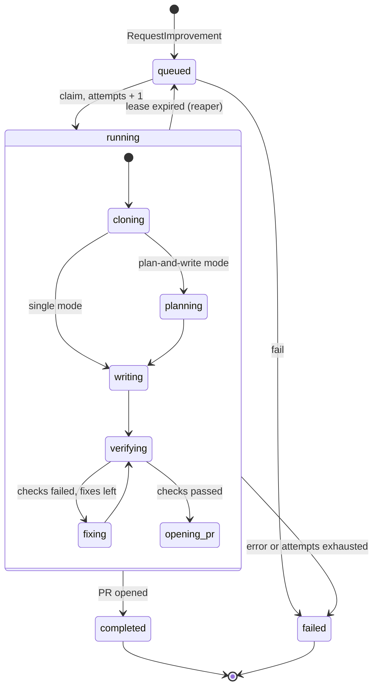

# Architecture

## Layers (DDD / ports & adapters)

Dependencies point inward. `domain` has no framework or I/O imports; `application` talks to the outside world
only through ports. Both rules are enforced by ESLint (`no-restricted-imports`).



`src/composition/*.module.ts` is the composition root: it binds adapters to port tokens
(`{ provide: GIT_PORT, useFactory: … }`) and builds the framework-free use cases with `useFactory`.

## Runtime topology



`main.ts` runs the API and, with `RUN_WORKER=true`, the worker in the same process. `main.worker.ts` runs
only the worker; any number of worker processes can share the database because claiming is atomic.

## Job state machine



Constraints enforced at two levels:

| Rule | Domain | Database |
| --- | --- | --- |
| One running job per repository | `JobSchedulingPolicy.canStart` | `one_running_job_per_repo` partial unique index + `NOT EXISTS` in the claim |
| One active job per file | `JobSchedulingPolicy.canRequest` | `one_active_job_per_file` partial unique index |
| No lost updates | `ImprovementJob.version` | `UPDATE … WHERE version = ?` |

## Job pipeline (ProcessNextJob)

```mermaid
sequenceDiagram
  autonumber
  participant W as Worker slot
  participant Q as JobQueue (SQLite)
  participant G as Git
  participant C as Jest runner
  participant A as Claude CLI
  participant V as ImprovementVerifier
  participant H as GitHub API

  W->>Q: claimNext(workerId, lease)
  Note over W: heartbeat extends lease every lease/3
  W->>G: shallow clone, create branch coverage/file-slug-jobid
  W->>W: delete .claude/, CLAUDE.md (hardening)
  W->>C: npm ci --ignore-scripts; jest --findRelatedTests (before)
  W->>A: planner (read-only tools) → TestPlan JSON (zod + domain validation)
  W->>A: writer (Read/Write/Edit, Bash(npx jest:*))
  loop until verified or fix attempts exhausted
    W->>C: jest --findRelatedTests (after)
    W->>G: git status
    W->>V: only *.test.ts changed? tests pass? coverage up?
    alt failed and attempts left
      W->>A: fixer (failures + Jest output)
    end
  end
  W->>G: git add test files, commit, push --force (job-owned branch)
  W->>H: open PR (returns existing open PR for the branch on retry)
  W->>Q: complete(prUrl, coverageAfter)
```

Every phase change is persisted *before* the slow work of that phase, so the dashboard shows live progress and
a crash leaves an accurate record. Each save first checks the lease handle and then the optimistic version:
a worker that lost its job abandons it without writing.

## Failure handling summary

| Situation | What happens |
| --- | --- |
| Clone / npm / Jest / AI / push / PR error | Job `failed` in the phase where it happened, error stored, workspace kept if `KEEP_FAILED_WORKSPACES` |
| Verification fails | Fixer runs with failures + Jest output, up to `AI_MAX_FIX_ATTEMPTS`; then `failed` |
| External process hangs | Killed (whole process group) after `PROCESS_TIMEOUT_MS` / `AI_TIMEOUT_MS` |
| Worker crashes / is killed | Lease expires; reaper (on startup and every lease/2) requeues, or fails after `JOB_MAX_ATTEMPTS`; the retry clones into a fresh per-attempt workspace |
| Worker paused, job reassigned | Heartbeat reports "lost" or the next save hits a version conflict → job abandoned by the stale worker |
| Crash after push / after PR | Retry force-pushes the same job branch; PR adapter returns the already open PR |
| Server restarts during a scan | Scan older than 3 × `PROCESS_TIMEOUT_MS` is marked failed by the reaper |
| Graceful shutdown (SIGTERM) | Stop claiming, wait ≤ 10 s, kill child process groups; leases expire and jobs are requeued |
